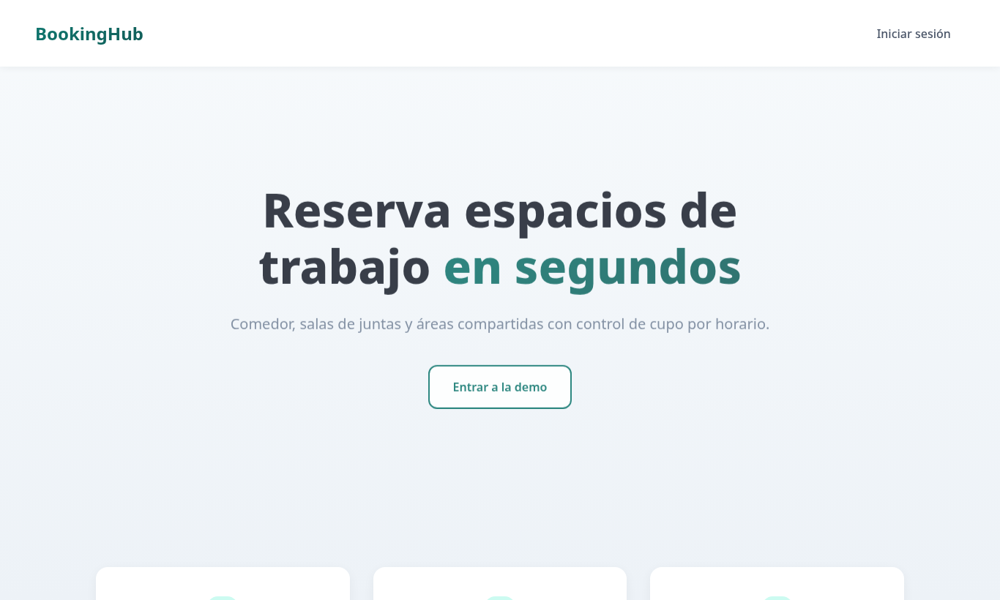
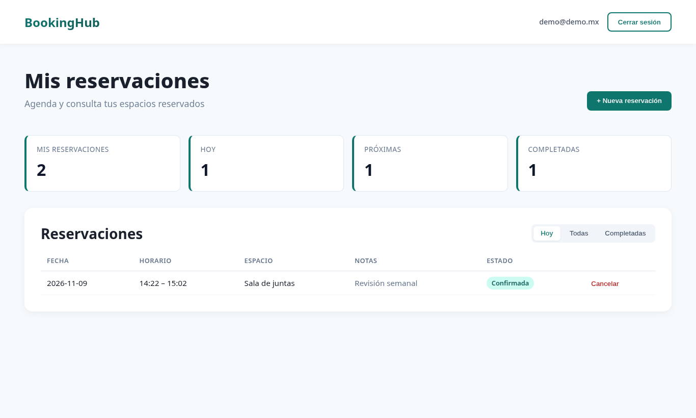
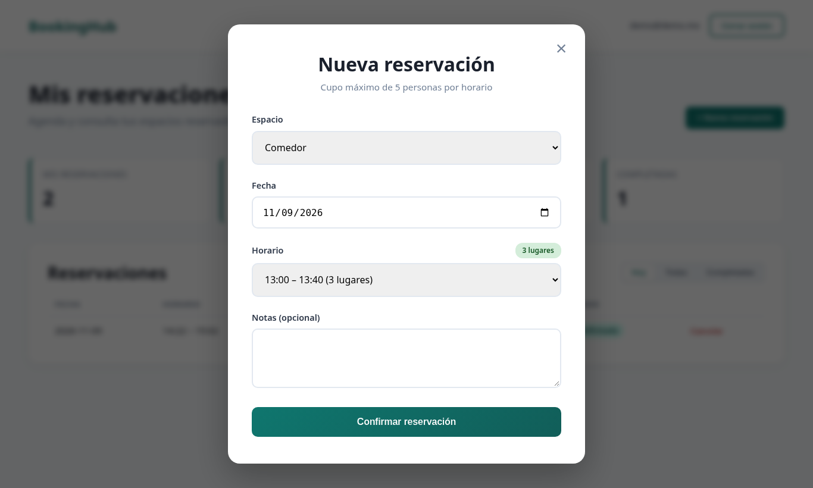
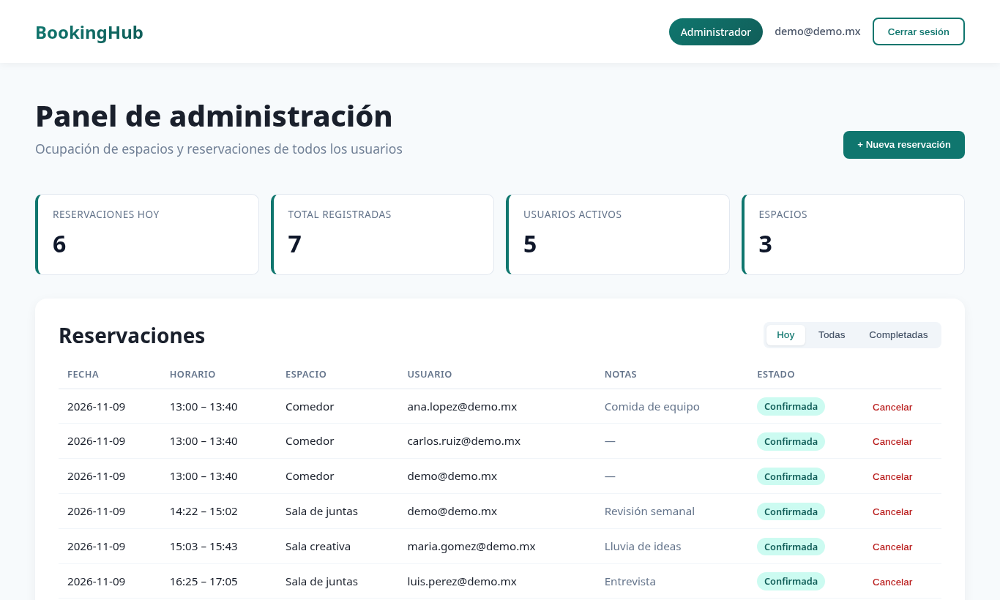

# BookingHub

**Demo:** https://joshuadh1409.github.io/booking-hub/

Reservación de espacios de trabajo (comedor, salas de juntas, áreas compartidas) con control de cupo por horario. React + TypeScript + Vite.

## Vista









## Qué hace

- **Colaborador:** crea reservaciones por espacio, fecha y horario; consulta hoy / todas / completadas y cancela
- **Administrador:** ve las reservaciones de todos los usuarios, ocupación del día y usuarios activos
- Cupo máximo por horario (5) con disponibilidad en tiempo real; los horarios llenos se bloquean
- Persistencia en `localStorage` con datos de ejemplo; sin backend

## Stack

- React 19 + TypeScript
- Vite 7
- CSS por módulo de pantalla (`src/Styles/`)

## Cómo correr

```bash
npm install
npm run dev
```

Build para GitHub Pages:

```bash
VITE_BASE=/booking-hub/ npm run build
```

Acceso demo: cualquier correo y contraseña; elegir perfil Colaborador o Administrador.

## Estructura

```
src/
  App.tsx              # sesión y navegación por hash
  data.ts              # modelo, horarios, cupo, almacenamiento
  Pages/
    Landing.tsx
    Login.tsx / Register.tsx
    Dashboard.tsx      # panel colaborador / administrador
    NewReservation.tsx
  Styles/
```

## Licencia

Uso libre para adaptar y desplegar bajo tu responsabilidad.
